# 05 · Racing Lab: ML pojmy vysvetlené na autíčkach

🇬🇧 [English version](README.md) · 📘 [Tutoriál krok za krokom](TUTORIAL.sk.md)

Malý 2-D pretekársky simulátor v Pythone, kde sa autíčka učia prejsť trať čo najrýchlejšie. Nie je to jednorazový projekt, ale **vizuálne laboratórium, ktoré rastie spolu s roadmapou**: krok tu dostane kapitolu **vtedy, keď sa jeho pojem na autíčka prirodzene hodí**. Kroky, kde by to bolo nasilu (fine-tuning LLM, RAG, agenti), dostanú iný vizuálny príklad priamo v danom kroku. Každú si môžeš pozrieť naživo s `--watch`.


## Najprv jednoducho
Predstav si autíčko na trati. V každom okamihu dostane niekoľko čísel, ktoré opisujú vzdialenosť od okraja cesty a jeho rýchlosť. Musí zvoliť dve veci: **kam zatočiť a koľko pridať alebo ubrať plyn**. Simulátor potom posunie auto, skontroluje náraz a zmeria postup a čas kola.

Každá kapitola ukazuje iný spôsob, ako tieto rozhodnutia robiť. Najprv autá ovládajú jednoduché pravidlá, potom sieť napodobňuje skúseného vodiča a neskôr sa učí z vlastných jázd podľa odmeny za postup. Pri učení pokusom a omylom vidí výsledok akcie, napríklad náraz alebo rýchlejší prejazd, a postupne upravuje svoje rozhodnutia. Jednotlivé kapitoly sú samostatné experimenty; prvé kapitoly ešte autá netrénujú.

**Ako spoznáme zlepšenie:** sledujeme počet dokončených kôl na tratiach, ktoré auto pri tréningu nevidelo, a čas na tých istých úspešne dokončených tratiach. V kapitole 12 sa dvom z troch behov učenia pomocou odmeny podarilo dokončiť všetkých 50 neznámych tratí; tretí dokončil 43. Na spoločných dokončených tratiach boli úspešné behy približne o 34 % rýchlejšie než pravidlový vodič. GIFy ukazujú správanie, tabuľky hovoria, či sa zlepšenie opakuje.

## Kapitoly

| Kap. | Krok | Čo vidíš na autíčkach | Koncept | Stav |
|---|---|---|---|---|
| [01 · Batching](#kap-01--batching-200-mozgov-v-jednom-násobení-matíc) | [01](https://github.com/kavicka/01-setup-benchmark/blob/main/README.sk.md) | 200 áut s náhodnými mozgami, všetky v jednom násobení matíc | dávkové tenzory, CPU vs GPU, meranie času | ✅ |
| [02 · Reťazové pravidlo a gradient descent](#kap-02--reťazové-pravidlo-a-gradient-descent) | [02](https://github.com/kavicka/02-calculus-chain-rule/blob/main/README.sk.md) | brzdiace auto sa učí zastaviť na čiare (backprop cez 90 časových krokov); 3 autá z krokov GD pretekajú | reťazové pravidlo, derivácia, gradient descent | ✅ |
| [03 · Vektory a matice](#kap-03--vektory-a-matice) | [03](https://github.com/kavicka/03-linear-algebra-shapes/blob/main/README.sk.md) | vektor smeru auta a trate, skalárny súčin, rotačná matica, lúče | vektory, R(θ), lineárne sústavy | ✅ |
| [04 · Učenie napodobňovaním](#kap-04--neurónová-sieť-na-mojom-micrograde-sa-učí-jazdiť) | [04](https://github.com/kavicka/04-autograd-makemore/blob/main/README.sk.md) | MLP na mojom autograde jazdí po nevidených tratiach, neuróny svietia | MLP, MSE, backprop, train/test, DAgger | ✅ |
| [06 · Predpoveď zriedkavých nabúraní](#kap-06--predpoveď-zriedkavých-nabúraní) | [06](https://github.com/kavicka/06-probability-bayes-roc) | každé auto ukazuje riziko nabúrania; červený krúžok = skutočný poplach, oranžový = falošný | pravdepodobnosť, nevyvážené triedy, ROC-AUC vs precision–recall | ✅ |
| [11 · Jazda z pixelov](#kap-11--jazda-z-pixelov) | [11](https://github.com/kavicka/11-image-classifier-pytorch/blob/main/README.sk.md) | žiadne lúče: CNN jazdí z obrázka 64×64 po neznámych tratiach, Grad-CAM ukazuje, kam sa pozerá | konvolúcia, DAgger na pixeloch, Grad-CAM vs HiResCAM | ✅ |
| [12 · Reinforcement learning](#kap-12--reinforcement-learning) | po [11](https://github.com/kavicka/11-image-classifier-pytorch/blob/main/README.sk.md) | žiadny učiteľ: PPO sa učí z postupu mínus nabúrania a prekoná časy kôl baseline o 34 % | RL, PPO, výhoda, prieskum, seedy | ✅ |
| ďalej | kroky, kde sa to hodí | jedna kapitola za vhodný krok | pozri [plán nižšie](#ďalšie-kapitoly) | 🚧 |

## Simulátor (spoločný pre všetky kapitoly)

| Časť | Súbor | Ako funguje |
|---|---|---|
| Trate | `racing/track.py` | Uzavretá slučka: polomer = súčet sínusoviek (harmonické 2–6) s náhodnou amplitúdou. 10 tréningových tratí (seed 0–9) a 10 **nevidených testovacích** (seed 100–109). |
| Auto | `racing/car.py` | Arkádová fyzika: poloha, smer, rýchlosť. Vstupy: `steer ∈ [−1, 1]` (zatáčanie), `throttle ∈ [−1, 1]` (plyn/brzda). Všetkých N áut sa počíta naraz cez NumPy polia. |
| Senzory | `racing/car.py` | 7 lúčov od −90° po +90°. Prienik lúča so stenou je sústava 2×2 riešená Cramerovým pravidlom. Pozorovanie = 7 vzdialeností / 220 + rýchlosť / max → **8 čísel**. |
| Baseline vodič | `racing/drivers.py` | Napísaný ručne: zatáča tam, kde je viac miesta, cieľová rýchlosť úmerná voľnému miestu vpredu. Gombík `aggression`. |
| Kreslenie | `racing/render.py` | pygame: ten istý kód kreslí živé okno (`--watch`) alebo snímky do GIFu (bez okna). |

Auto vidí len 8 čísel a vracia 2. Dosť málo na to, aby sa dala pochopiť každá váha.

## Kap. 01 · Batching: 200 mozgov v jednom násobení matíc

**Krok 01 naučil:** GPU je rýchle len pri veľkých dávkach; treba merať a pred zastavením stopiek synchronizovať.

**Na autíčkach:** každé z 200 áut má vlastný mozog, MLP 8 → 16 → 2. Dá sa počítať Python cyklom cez autá, alebo jedným dávkovým násobením matíc `(N,1,8) @ (N,8,16)`. Výsledok je rovnaký (overené cez `allclose`), čas úplne iný.


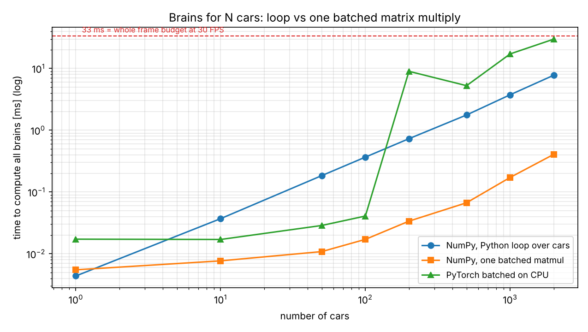

| Áut | Python cyklus | Dávkové NumPy | Zrýchlenie |
|---|---|---|---|
| 10 | 0,037 ms | 0,008 ms | 5× |
| 200 | 0,73 ms | 0,034 ms | **21×** |
| 2000 | 7,8 ms | 0,41 ms | 19× |

Pri 2000 autách by cyklus zjedol štvrtinu 33 ms rozpočtu na snímku. Náhodné mozgy väčšinou nabúrajú, a to je v poriadku: zatiaľ ich nikto neučil. *(Merané v cloude, len CPU. Na Macu skript zmeria aj PyTorch na MPS.)*

## Kap. 02 · Reťazové pravidlo a gradient descent

**Krok 02 naučil:** reťazové pravidlo (backprop na `e = a·b, d = e + c, L = d²`), overené tromi spôsobmi: ručne, numericky a v PyTorchi; derivácia je sklon a gradient descent kráča z kopca dole.

### Časť A · Reťazové pravidlo na brzdiacom aute (`ch02b_chain_rule.py`)

Auto prichádza rýchlosťou 300 px/s a brzdí konštantnou silou `b`. Má zastaviť presne na bielej čiare na 250 px. Jeden krok fyziky je

```
v[k+1] = max(0, v[k] − b·dt − drag·v[k]·dt)
x[k+1] = x[k] + v[k+1]·dt
```

a loss je `L(b) = (x[N] − 250)²`. Miesto zastavenia závisí od `b` cez **90 vnorených krokov**, takže `dL/db` je dlhá reťaz: `dL/dx[N] · Σ dx[N]/dv[k] · dv[k]/db`. Je to presne graf z kroku 02, len dlhší. Skript ho počíta tými istými tromi spôsobmi:

| Gradient pri b = 15 | Hodnota |
|---|---|
| ručne (spätný cyklus cez čas, `manual_grad`) | −650,934 |
| numericky, centrálna diferencia | −650,934 |
| PyTorch autograd | −650,934 |

Všetky tri sa zhodujú v každom kroku GD. Gradient descent potom posunie `b` z 15 na **66,5** za 11 krokov; auto zastaví na 250,4 px.


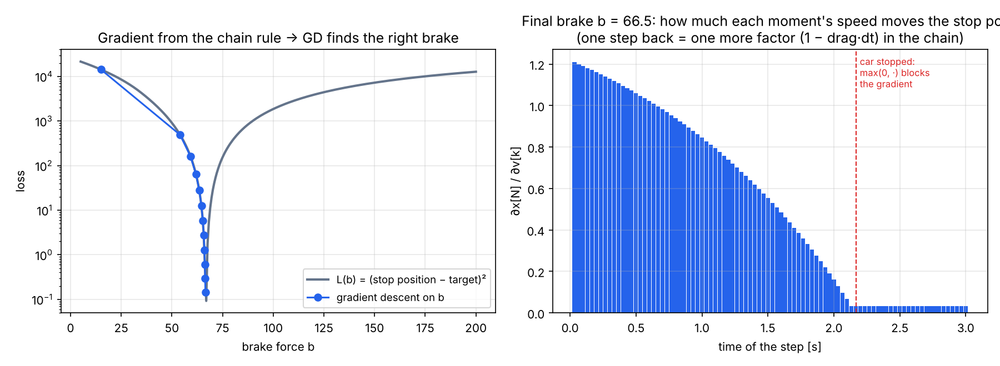

Pravý graf je reťazové pravidlo v obrázku: každý krok späť v čase pridá do reťaze ďalší činiteľ `(1 − drag·dt)`, preto skorá rýchlosť ovplyvní miesto zastavenia viac. Keď auto zastane, `max(0, ·)` má deriváciu 0 a gradient zastaví: rovnako ako ReLU v sieti.

### Časť B · Gradient descent na gombíku vodiča (`ch02_gradient.py`)

**Na autíčkach:** baseline vodič má jeden parameter `a` = agresivita. Loss je `J(a)` = priemerný čas kola na 10 tréningových tratiach (nabúranie sa počíta ako 30 s). Príliš opatrný → pomalý. Príliš odvážny → búra. Deriváciu `dJ/da` odhadneme numericky a upravíme `a ← a − lr · dJ/da`.

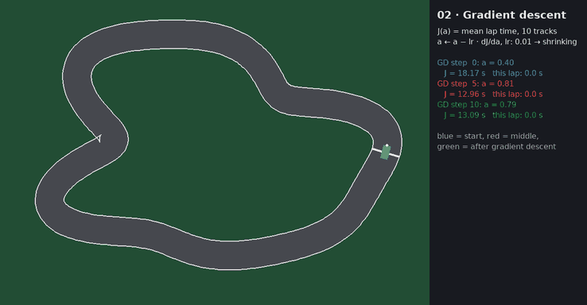
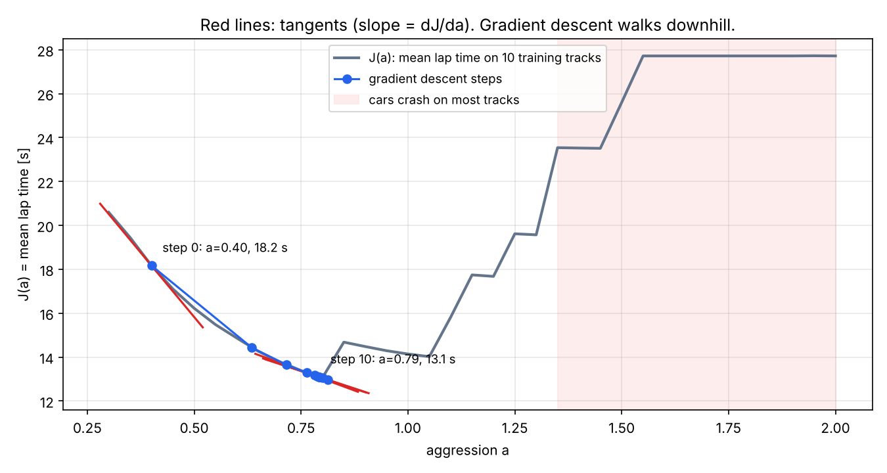

| | a | J(a) |
|---|---|---|
| štart (krok GD 0) | 0,40 | 18,17 s |
| po 10 krokoch GD | **0,79** | **13,09 s** |

Ponaučenie: s pevným learning rate GD skákal tam a späť cez „útes nabúrania“ okolo a ≈ 0,85, kde loss nie je hladká. Pomohol zmenšujúci sa learning rate (`0,01 · 0,75^k`).

## Kap. 03 · Vektory a matice

**Krok 03 naučil:** tvary (shapes), násobenie matíc, rotácia, skalárny súčin.

**Na autíčkach:**
- modrá šípka `h = R(θ) · [1, 0]`: smer auta je rotačná matica aplikovaná na „dopredu“;
- zelená šípka `t`: smer trate;
- `h · t = cos α`: 1 znamená zarovnané s traťou, 0 znamená jazdu naprieč traťou;
- žlté lúče: každý je `R(θ + posun) · [1, 0]`, odrezaný tam, kde narazí na stenu. Ten náraz je sústava 2×2; `det = 0` znamená, že lúč je so stenou rovnobežný.


## Kap. 04 · Neurónová sieť na mojom micrograde sa učí jazdiť

**Krok 04 naučil:** autograd (`Value`, `backward()`), MLP, loss, gradient descent, rozdelenie train/val.

**Na autíčkach:** študentská sieť MLP 8 → 8 → 2 postavená z **môjho vlastného `micrograd` z kroku 04** (žiadny PyTorch) sa učí napodobniť učiteľa.
1. **Behaviour cloning (klonovanie správania):** učiteľ (baseline vodič) odjazdí 10 tréningových tratí; každá 3. snímka je príklad `(8 senzorov → zatáčanie, plyn)`. 600 krokov MSE + `backward()` + SGD.
2. **DAgger:** teraz jazdí *študent*, učiteľ povie, čo by urobil on v tých situáciách, tie príklady pridáme a trénujeme ďalej (3 kolá).
3. **Test:** obaja jazdia na 10 testovacích tratiach, ktoré nikdy nevideli.

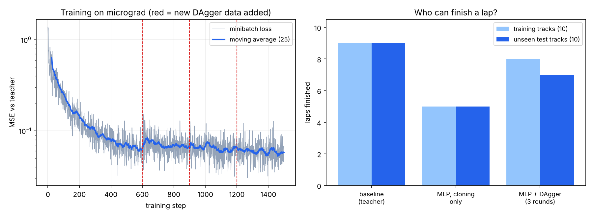

| Vodič | Dokončené tréningové trate | Dokončené nevidené trate | Priemerné kolo (test) |
|---|---|---|---|
| Baseline (učiteľ) | 9/10 | 9/10 | 11,74 s |
| MLP, len klonovanie | 5/10 | 5/10 | 11,33 s |
| MLP + DAgger (3 kolá) | **8/10** | **7/10** | 11,54 s |

Prečo samotné klonovanie nestačí: učiteľ nerobí chyby, takže v dátach nie je ani jeden príklad typu „som príliš blízko steny, čo teraz?“. Študent spraví malú chybu, ocitne sa tam, kde učiteľ nikdy nebol, a chyby sa nabaľujú. DAgger pozbiera presne tieto situácie (1069 → 3957 príkladov). Loss na ľavom grafe pri každej červenej čiare trochu poskočí, lebo nové príklady sú ťažšie.

Chceš byť učiteľom ty? `uv run python -m chapters.play` nahrá tvoje kolá (šípky), potom `uv run python -m chapters.ch04_imitation --demos data/my_laps.npz`.

## Kap. 06 · Predpoveď zriedkavých nabúraní

**Krok 06 naučil:** pravdepodobnosť a Bayes, a prečo ROC-AUC skrýva nevyváženosť tried, kým precision–recall ju ukáže.

**Na autíčkach:** autá s náhodnou `aggression` (0,5–1,7, niektoré príliš odvážne) a zašumeným zatáčaním jazdia po 10 tréningových a 10 nevidených testovacích tratiach. Každá snímka každého auta je jeden príklad: 8 hodnôt senzorov a označenie *„nabúra v nasledujúcej sekunde“*. Nabúrania sú zriedkavé, takže dáta sú prirodzene nevyvážené. Logistická regresia (scikit-learn) sa učí P(nabúranie do 1 s | senzory).

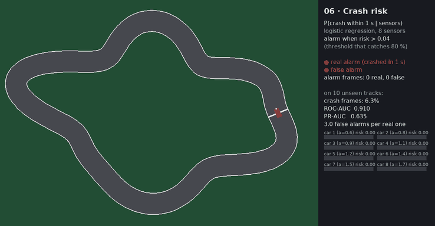
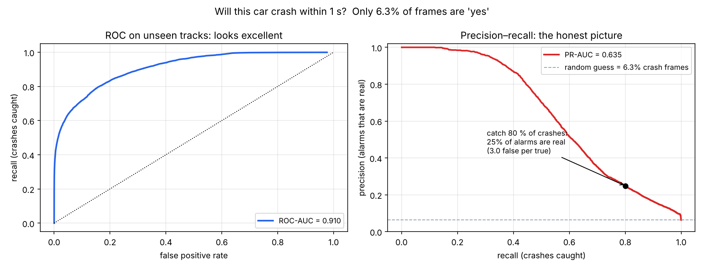

| Nevidené testovacie trate | Hodnota |
|---|---|
| snímok / snímok s nabúraním do 1 s | 90 620 / **6,3 %** |
| ROC-AUC | **0,910** |
| PR-AUC (average precision) | 0,635 (náhodný odhad = 0,063) |
| precision, keď zachytí 80 % nabúraní | **0,25** → 3,0 falošné poplachy na jeden skutočný |
| presnosť „vždy povedz bezpečné“ | 93,7 % |

ROC-AUC hovorí „výborné“. Precision–recall hovorí: ak chceš zachytiť väčšinu nabúraní, tri zo štyroch poplachov sú falošné. Platí oboje; odpovedajú na iné otázky. V GIFe je prah poplachu ten, ktorý zachytí 80 % nabúraní; červený krúžok znamená, že auto naozaj do 1 s nabúralo, oranžový je falošný poplach.

## Kap. 11 · Jazda z pixelov

**Krok 11 ma naučil:** konvolúciu, trénovací cyklus v PyTorchi, MPS, Grad-CAM.

**Na autíčkach:** lúče sú preč. Auto dostane obrázok cesty zhora s rozmerom 64×64, otočený tak, aby „hore“ bol vždy jeho smer jazdy, a k tomu rýchlosť ako jedno číslo. Všetko ostatné je ako v kap. 04: učí baseline a DAgger pridáva vlastné chyby študenta (5 kôl, asi 19 000 snímok). Zrkadlenie obrázka s otočením znamienka zatáčania zdvojnásobí dáta, inak by trať proti smeru hodinových ručičiek ukazovala pravotočivú zákrutu len zriedka.

Dvaja študenti dostanú rovnaký recept, každý s 3 seedmi: CNN (154 882 váh) a MLP na sploštených pixeloch (133 378 váh).

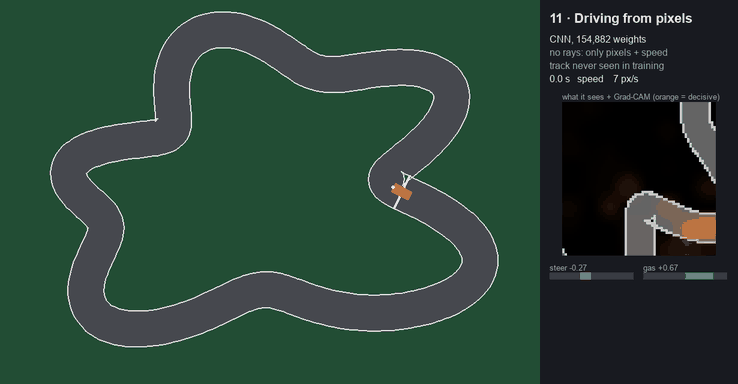
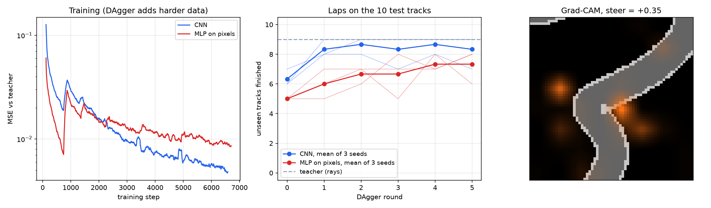

| Vodič | Vstup | Dokončené z 10 testovacích tratí (3 seedy) | Dokončené z 50 neznámych tratí (3 seedy) | Priemerný postup na 50 tratiach |
|---|---|---|---|---|
| Baseline (učiteľ) | 7 lúčov + rýchlosť | 9 | **43** | 93,9 % |
| CNN + DAgger | pixely + rýchlosť | 7, 9, 9 | **35, 40, 39** (priemer 38,0) | 86,0, 92,8, 90,7 % |
| MLP + DAgger | pixely + rýchlosť | 6, 8, 8 | 36, 36, 32 (priemer 34,7) | 90,8, 85,0, 82,7 % |

CNN nepotrebuje geometriu lúčov a aj tak sa dostane blízko k učiteľovi, ktorý ju má: 38 kôl z 50 oproti 43. Končí zhruba s polovičnou tréningovou loss oproti MLP a na 50 tratiach ho v priemere porazí o 3 kolá. Seedy sa prekrývajú (najhorší CNN dokončí 35, najlepší MLP 36), takže pri 3 seedoch je to trend, nie dôkaz. Desať tratí by to zakrylo: prvý beh tejto kapitoly ukázal 7 vs 6 a len jeden seed.

Na rozdiel od klasifikátorov v kroku 11 táto CNN **nekončí** global average poolingom. Klasifikátor sa pýta, *či* je niečo na obrázku; vodič sa pýta, *kde* je cesta, a priemerovanie by túto informáciu zahodilo.

**Chyba, ktorú stojí za to si nechať.** Klasický Grad-CAM priemeruje gradient cez celú mapu príznakov, čo platí pre hlavu s global average poolingom. Tu hlava sploští mapu, takže ten istý kanál môže v rôznych bunkách znamenať opačné veci. V prvom behu heatmapa sedela na prázdnej tráve: 9,7 % z nej pri obrubníkoch, ktoré zaberajú 21 % obrázka. Násobenie gradientu a aktivácie po bunkách (HiResCAM) dáva 26,6 % oproti 21,4 % na 223 snímkach. To je lepšie než náhoda, ale stále skromné, takže oranžové fľaky ber ako nápovedu, nie ako vysvetlenie.

## Kap. 12 · Reinforcement learning

**Krok 11 skončil takto:** auto, ktoré napodobňuje učiteľa, môže byť najviac také dobré ako učiteľ. Čo ak nikto neučí?

**Na autíčkach:** PPO, napísané ručne v PyTorchi. 60 áut jazdí na 10 tréningových tratiach a dostáva jediný signál: postup po trati mínus trest za nabúranie. Nikto nepovie, aká hodnota riadenia by bola dobrá. Sieť je 8 → 64 → 64 → 2 (4 866 váh v politike) na tých istých 8 číslach ako v kap. 04.

- **Zber.** Všetky autá jazdia 200 krokov s aktuálnou politikou a gaussovským šumom, aby skúšali nové veci.
- **Posúdenie.** Druhá sieť, kritik, predpovedá budúcu odmenu. GAE premení rozdiel medzi predpoveďou a realitou na *výhodu*: o koľko lepšia bola táto akcia, než sa čakalo?
- **Opatrné zlepšenie.** Akcie s kladnou výhodou budú pravdepodobnejšie. Zmena je orezaná na ±20 %, lebo tieto dáta nehovoria nič spoľahlivé o politike ďaleko od tej, ktorá ich nazbierala.
- **Hodiny nie sú nehoda.** Auto zastavené po 40 s malo ešte budúcnosť, takže učiaci sa algoritmus tam použije odhad kritika. Nehoda koniec naozaj je: budúcnosť má hodnotu 0.

Kontrolná skupina má rovnakú sieť, rovnaké trate aj rovnakých 50 neznámych tratí, ale napodobňuje baseline cez DAgger, ako v kap. 04.

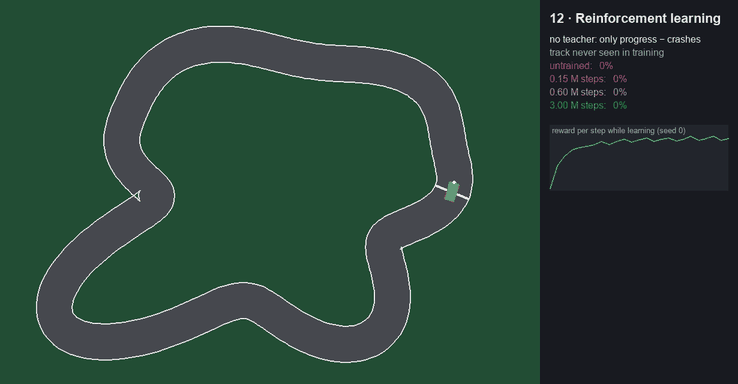
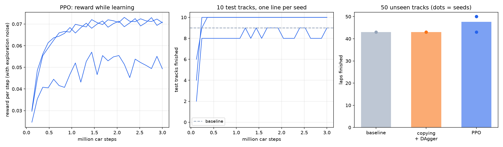

GIF ukazuje štyri fázy jedného tréningu, ktoré pretekajú na neznámej trati.

| Vodič | Učí sa z | Skúsenosť | Dokončené z 50 neznámych tratí (3 seedy) | Priemerný postup | Priemerné kolo, neznáme trate |
|---|---|---|---|---|---|
| Baseline | ručne písané pravidlá | žiadna | **43** | 93,9 % | 11,44 s |
| Napodobňovanie + DAgger | odpovede baseline | asi 19 100 snímok | 43, 43, 43 | 93,9 % | 11,43–11,47 s |
| PPO | len odmena | 3 000 000 krokov áut | **50, 43, 50** | 100, 72,2, 100 % | **7,63–7,70 s** |

Časy kôl v tejto tabuľke zahŕňajú to, čo daný vodič dokončí. Len na tratiach, ktoré dokončia obaja, potrebuje PPO 7,45–7,67 s oproti 11,43–11,44 s baseline, teda asi **o 34 % menej času**.

Napodobňovanie sa zhoduje s učiteľom tak presne, že zlyháva rovnako, a to je ponaučenie tejto kapitoly. Jeho strop je učiteľ. PPO učiteľa nemá, takže nemá ani strop, a dva seedy z troch prejdú každú neznámu trať. Cena je skúsenosť: 3 000 000 krokov je asi 28 hodín simulovanej jazdy, 157× viac, než potrebovalo napodobňovanie. V reálnom čase je to tu stále lacné: 193 s na seed na jednom jadre CPU (Mac mini M4 Pro; malé MLP z MPS nič nezíska).

**Chyba, ktorú stojí za to si nechať.** V prvom behu seedy dokončili 50, 43 a 42 z 50 tratí a slabšie dva mali priemerný postup okolo 72 %, a to nesedí: 43 dokončených kôl plus 7 bežných nehôd by dalo viac. Čísla hovorili, že zlyhania sa takmer nepohli zo štartu, tak som sa pozrel. Viaceré autá boli v poriadku a jazdili **dozadu**, až 3,9 kola opačným smerom. Riadenie v tomto simulátore otáča auto aj pri rýchlosti 0, takže pri štarte z miesta sa politika otočila na mieste a nič v jej 8 vstupoch neukazuje, ktorým smerom kolo ide. Tréning jej tento problém nikdy neukázal, lebo autá sa vždy objavili v pohybe, 0–200 px/s. Polovica objavení je teraz štart z miesta. Seed 2 tým skočil zo 42 na 50 kôl a seed 0 ostal na 50.

Seed 1 to neopravilo, stále dokončí 43 so 4 kolami opačným smerom. Jeho odmena ostáva okolo 0,05 na krok oproti 0,07 pri zvyšných dvoch, takže uviazol v horšom návyku. Šesť z jeho siedmich zlyhaní je na tratiach, kde zlyháva aj baseline. Tri seedy nepovedia, ako často sa to stáva, takže výsledok čítaj ako „väčšinou výborné, niekedy nie“ a všimni si, čo to znamená: jeden beh PPO nie je spoľahlivý výsledok.

**Limity.** Opravu štartu z miesta som vybral po pohľade na zlyhania na 50 neznámych tratiach, takže tie už pre PPO nie sú úplne nezávislé. Štart z miesta je jediná slabina tejto politiky, ktorú som overoval, a je to skutočná medzera v tréningu, nie úprava na jednu trať, ale čisté tvrdenie by potrebovalo nové trate. Všetky trate idú proti smeru hodinových ručičiek, takže „zatoč doľava“ je zadarmo nápoveda, ktorú by zrkadlená trať vzala. Evolúcia, plánovaná do tohto porovnania, zatiaľ nie je postavená.

## Ďalšie kapitoly

Kapitoly pribúdajú len tam, kde autíčka naozaj pomôžu. Aktuálny plán:

| Krok (fáza) | Nápad na kapitolu |
|---|---|
| P2 · klasické ML, evaluácia | **Zovšeobecňuje to?** Všetci vodiči × train/val/test trate v jednej tabuľke; overfitting na 1 trati vs na 10 tratiach; výber podľa validácie. Plus **evolúcia**: optimalizácia bez gradientov v porovnaní s GD. |
| P10 · inferencia | export vodiča do ONNX / Core ML, 1000 áut naraz, FPS pred/po, kvantizácia. |
| P11 · MLOps | každý tréning zalogovaný v MLflow; CI kontrola zlyhá, ak je nový model na testovacích tratiach pomalší. |

Kroky **bez** kapitoly na autíčkach, lebo by to bolo nasilu. Dostanú vlastný vizuálny príklad priamo v danom kroku:

| Krok | Lepší príklad ako autíčka |
|---|---|
| P4 · transformery | heatmapy attention na skutočných vetách, malý GPT generuje text po tokenoch |
| P5–P6 · fine-tuning, retrieval | odpovede modelu pred/po fine-tuningu, embeddingy dokumentov v 2-D |
| P7–P9 · RAG, agenti, evaly | ClaimPilot: ktoré úryvky sa našli a prečo, záznam krokov agenta, tabuľky skóre z evalov |
| Capstone | ClaimPilot v2 od začiatku do konca |

## Spustenie

Kapitola 04 importuje `micrograd` z kroku 04: naklonuj [04-autograd-makemore](https://github.com/kavicka/04-autograd-makemore) vedľa tohto repozitára (do rovnakého nadradeného priečinka).

```bash
cd 05-racing-lab
uv sync
uv run python -m chapters.ch01_batch          # benchmark + graf + GIF   (pridaj --watch pre živé okno)
uv run python -m chapters.ch02b_chain_rule    # reťazové pravidlo na brzdiacom aute, pár sekúnd
uv run python -m chapters.ch02_gradient       # ~1 min
uv run python -m chapters.ch03_vectors --watch
uv run python -m chapters.ch04_imitation      # ~1,5 min, autograd v čistom Pythone je pomalý
uv run python -m chapters.ch06_crash_risk     # predpoveď nabúrania, ~1 min
uv run python -m chapters.ch11_pixels        # CNN vs MLP na pixeloch, 3 seedy na MPS (s --watch uložený model)
uv run python -m chapters.ch12_ppo            # PPO + kontrola DAgger, 3 seedy, ~4 min na seed na CPU (s --watch uložený beh)
uv run python -m chapters.play                # jazdíš ty, nahrá data/my_laps.npz
```

## Štruktúra

```
05-racing-lab/
├── racing/          # spoločný simulátor: track.py, car.py, drivers.py, sim.py, render.py
├── chapters/        # jeden skript za krok: ch01_batch.py, ch02_gradient.py, …, play.py
├── assets/          # GIFy a grafy
└── results_ch*.json # čísla za tabuľkami
```

## Obmedzenia
- Arkádová fyzika, bez driftu a priľnavosti; cieľom je učenie, nie fyzika.
- Baseline učiteľ nie je dokonalý (9/10), takže študent ho môže nanajvýš dorovnať.
- Výsledky na 10 + 10 tratiach sú zašumené: jedna trať navyše či menej posunie „dokončené“ o 10 %.
- Čísla pre GPU (MPS) v kap. 01 sa objavia len pri spustení na Macu.
